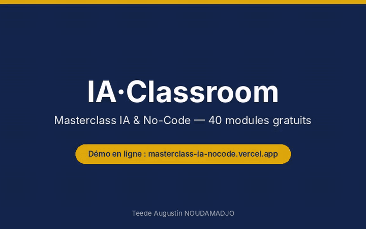
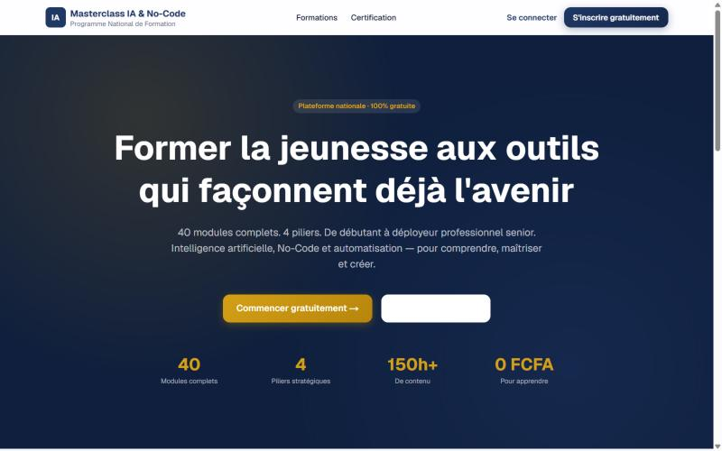
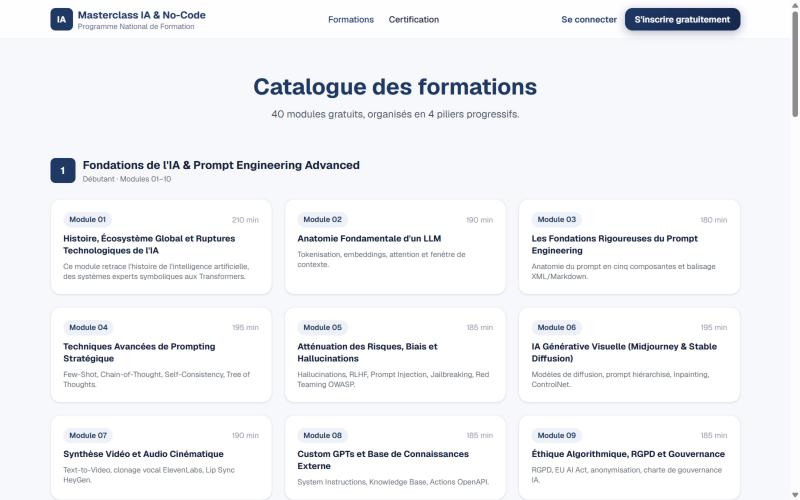
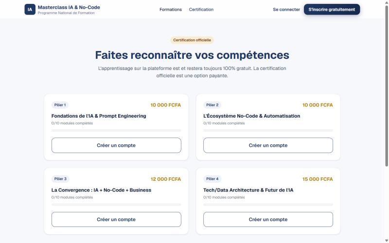
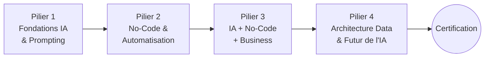
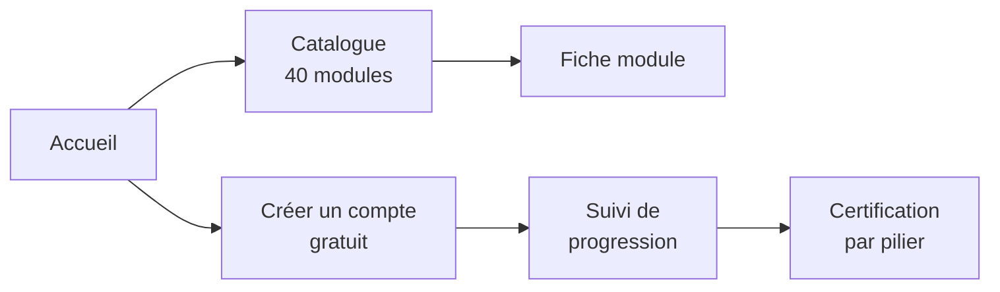

# IA·Classroom — Masterclass IA & No-Code

> **Former la jeunesse aux outils qui façonnent déjà l'avenir** : 40 modules gratuits en 4 piliers, du débutant au déployeur professionnel senior.

  
  

  

Démo animée. Cliquez sur <b>Vidéo HD</b> pour la version MP4, ou sur <b>Essayer en ligne</b> pour tester le site.

### 📸 Captures d'écran

<table>
  <tr>
    <td></td>
    <td></td>
    <td></td>
  </tr>
</table>

---

## Sommaire

1. [Le problème](#1-le-problème)
2. [Ingénierie pédagogique](#2-ingénierie-pédagogique)
3. [Le programme](#3-le-programme)
4. [Parcours utilisateur](#4-parcours-utilisateur)
5. [Modèle économique](#5-modèle-économique)
6. [Architecture et versions](#6-architecture-et-versions)
7. [Feuille de route](#7-feuille-de-route)

---

## 1. Le problème

Les formations à l'IA sont souvent **payantes, en anglais, ou trop théoriques**. Pour un étudiant ou un professionnel francophone, notamment en Afrique, le coût et la langue sont de vraies barrières. Pourtant, l'IA transforme déjà l'agriculture, la santé, la finance, l'éducation, le commerce et l'administration.

**IA·Classroom propose** :

- un apprentissage **100 % gratuit** (0 FCFA), en **français** ;
- un parcours **structuré** du débutant à l'avancé ;
- des contenus **pratiques**, avec plus de 150 heures estimées ;
- une **certification optionnelle** pour faire reconnaître ses compétences.

---

## 2. Ingénierie pédagogique

Le programme applique des principes d'enseignement éprouvés, issus de ma formation en mathématiques et en pédagogie (École normale supérieure) :

| Principe | Mise en œuvre |
|---|---|
| **Progressivité** | 4 piliers de difficulté croissante, chacun s'appuyant sur le précédent |
| **Objectifs explicites** | Chaque module annonce ce que l'apprenant saura faire à la fin |
| **Charge maîtrisée** | Durée affichée pour chaque module (de 180 à 220 min) |
| **Ancrage dans le réel** | Cas d'usage sectoriels et pilier dédié au business |
| **Évaluation** | Certification par pilier, avec suivi de progression (modules complétés) |

---

## 3. Le programme

| Pilier | Thème | Modules | Niveau |
|:---:|---|:---:|:---:|
| **1** | Fondations de l'IA & Prompt Engineering | 01 – 10 | 🟢 Débutant |
| **2** | Écosystème No-Code & Automatisation | 11 – 20 | 🟡 Intermédiaire |
| **3** | Convergence : IA + No-Code + Business | 21 – 30 | 🟠 Intermédiaire+ |
| **4** | Tech/Data Architecture & Futur de l'IA | 31 – 40 | 🔴 Avancé |

**Exemples de modules** : anatomie d'un LLM (tokenisation, embeddings, attention) · techniques avancées de prompting (few-shot, chain-of-thought) · atténuation des biais et hallucinations · éthique, RGPD et AI Act · automatisation avec Make et Zapier · webhooks et API.

---

## 4. Parcours utilisateur

L'expérience est pensée pour être **simple** : tout le catalogue est visible sans inscription, un seul bouton mène à la création de compte, et la progression s'affiche pilier par pilier.

---

## 5. Modèle économique

| Offre | Prix |
|---|---|
| Apprentissage (40 modules) | **Gratuit, pour toujours** |
| Certification pilier 1 ou 2 | 10 000 FCFA |
| Certification pilier 3 | 12 000 FCFA |
| Certification pilier 4 | 15 000 FCFA |

Le savoir reste gratuit ; seule la **reconnaissance officielle** est payante. Les tarifs sont en FCFA, adaptés au public visé.

---

## 6. Architecture et versions

| Version | Adresse | Technologie | Statut |
|---|---|---|---|
| **Masterclass (production)** | [masterclass-ia-nocode.vercel.app](https://masterclass-ia-nocode.vercel.app) | Next.js sur Vercel | ✅ En ligne |
| Prototype statique | — | HTML, CSS, JavaScript vanilla (≈ 43 Ko, 0 dépendance) | Archivé |
| Plateforme de classe | ia-classroom.vercel.app | Comptes, rôles enseignant / élève | 🚧 En développement (base de données à brancher) |

**Choix de conception**

| Choix | Pourquoi |
|---|---|
| **Contenu séparé de l'affichage** | Ajouter ou corriger un module ne touche pas à l'interface. |
| **Pages légères** | Idéal pour les connexions mobiles lentes, fréquentes chez le public visé. |
| **Hébergement Vercel** | HTTPS, CDN mondial et aucun serveur à administrer. |

---

## 7. Feuille de route

- [x] Catalogue complet des 40 modules en 4 piliers
- [x] Pages de certification par pilier
- [x] Mise en production (Masterclass)
- [ ] Brancher la base de données de la plateforme de classe (comptes, rôles enseignant / élève)
- [ ] Quiz auto-corrigés à la fin de chaque module
- [ ] Application installable (PWA) et mode hors ligne
- [ ] Intégration à l'espace Apprentissage de [Teedaïk](https://github.com/Teede-N/teedaik-showcase)

---

## 👤 Auteur

**Teede Augustin NOUDAMADJO**, Data Scientist Junior, passionné de transmission
Licence de mathématiques (École normale supérieure, Bénin) · Master Big Data & IA (ESTIAM Lyon)
[LinkedIn](https://www.linkedin.com/in/teede-noudamadjo) · teedeaugustinnoudamadjo41@gmail.com
