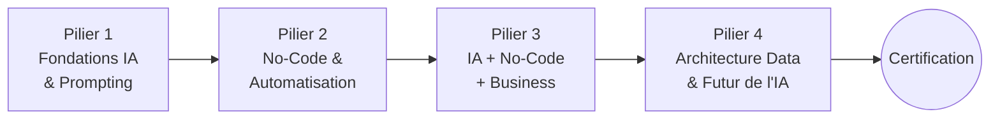
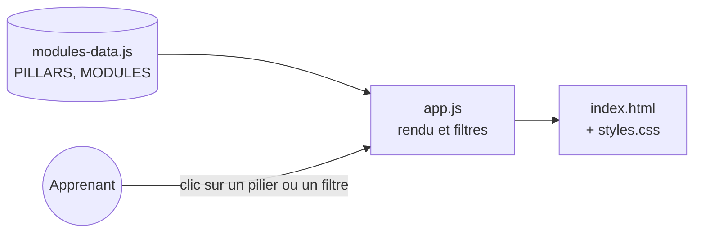

# IA·Classroom — Masterclass IA & No-Code


> **Se former gratuitement à l'intelligence artificielle et au no-code** : 40 modules répartis en 4 piliers, du débutant à l'avancé.

🌍 **Démo en ligne : [ia-classroom.vercel.app](https://ia-classroom.vercel.app)**

---

## Sommaire

1. [Le problème](#1-le-problème)
2. [Ingénierie pédagogique](#2-ingénierie-pédagogique)
3. [Le programme](#3-le-programme)
4. [Fonctionnalités](#4-fonctionnalités)
5. [Architecture technique](#5-architecture-technique)
6. [Choix de conception](#6-choix-de-conception)
7. [Feuille de route](#7-feuille-de-route)

---

## 1. Le problème

Les formations à l'IA sont souvent **payantes, en anglais, ou trop théoriques**. Pour un étudiant ou un professionnel francophone, notamment en Afrique, le coût et la langue sont de vraies barrières.

**IA·Classroom propose** :

- un parcours **100 % gratuit** (0 FCFA / 0 €) ;
- **en français** ;
- **structuré** : progression du débutant à l'avancé ;
- **pratique** : chaque module se termine par un exercice concret ;
- une **certification optionnelle** (9,99 €) pour valider ses compétences.

---

## 2. Ingénierie pédagogique

Le programme applique des principes d'enseignement éprouvés, issus de ma formation en mathématiques et en pédagogie (École normale supérieure) :

| Principe | Mise en œuvre |
|---|---|
| **Progressivité** | 4 piliers de difficulté croissante, chacun s'appuyant sur le précédent |
| **Objectifs explicites** | Chaque module annonce ce que l'apprenant saura faire à la fin |
| **Apprentissage actif** | Un exercice pratique par module : on apprend en faisant |
| **Ancrage dans le réel** | Le pilier 3 relie la technique aux usages business |
| **Évaluation finale** | Certification pour valider l'ensemble du parcours |

Chaque module suit la même structure, pour réduire la charge cognitive :

```
Résumé  →  Objectifs pédagogiques  →  Exercice pratique
```

---

## 3. Le programme

| Pilier | Thème | Modules | Niveau |
|:---:|---|:---:|:---:|
| **1** | Fondations de l'IA & Prompt Engineering | 01 – 10 | 🟢 Débutant |
| **2** | Écosystème No-Code & Automatisation industrielle | 11 – 20 | 🟡 Intermédiaire |
| **3** | Convergence : IA + No-Code + Business | 21 – 30 | 🟠 Intermédiaire+ |
| **4** | Tech/Data Architecture & Futur de l'IA | 31 – 40 | 🔴 Avancé |



**Exemple : module 01**, *Histoire, écosystème global et ruptures technologiques de l'IA*

- Situer les grandes vagues de l'IA depuis 1950
- Distinguer IA symbolique, machine learning et deep learning
- Identifier les acteurs clés et leur positionnement
- Comprendre les enjeux de souveraineté autour de l'IA

---

## 4. Fonctionnalités

- 📚 **Catalogue des 40 modules**, filtrable par pilier
- 🔍 **Fiche détaillée** de chaque module dans une fenêtre modale
- 🧭 Navigation fluide entre piliers, modules et certification
- 📱 **Design responsive** (mobile, tablette, ordinateur) et thème sombre
- ⚡ **Chargement quasi instantané** : aucun framework, aucune dépendance

---

## 5. Architecture technique

```
ia-classroom/
├── index.html        # structure : en-tête, piliers, modules, certification, à propos
├── styles.css        # thème (variables CSS), grilles responsives, composants
├── modules-data.js   # CONTENU : les 4 piliers et les 40 modules (données pures)
└── app.js            # LOGIQUE : rendu dynamique, filtres, fenêtre de détail
```

| Fichier | Taille | Rôle |
|---|---:|---|
| `modules-data.js` | 27 Ko | Données pédagogiques |
| `styles.css` | 8 Ko | Présentation |
| `index.html` | 4 Ko | Structure |
| `app.js` | 3 Ko | Comportement |
| **Total** | **≈ 43 Ko** | Plus léger qu'une seule image classique |



---

## 6. Choix de conception

| Choix | Pourquoi |
|---|---|
| **Séparer les données et l'affichage** | Ajouter ou corriger un module ne touche qu'à `modules-data.js`, sans risque de casser l'interface. Le contenu pourra plus tard venir d'une API ou d'une base. |
| **JavaScript vanilla, sans framework** | Moins de 45 Ko au total : idéal pour les connexions lentes ou mobiles, fréquentes chez le public visé. |
| **Site statique sur Vercel** | Hébergement gratuit, HTTPS et CDN mondial, rien à administrer. |
| **Variables CSS** | Le thème (couleurs, rayons, largeurs) se modifie en un seul endroit. |

---

## 7. Feuille de route

- [x] Catalogue complet des 40 modules et filtres par pilier
- [x] Déploiement en production
- [ ] Comptes apprenants et **suivi de progression**
- [ ] Rôles **enseignant / élève** (classes, devoirs), sur le modèle de Google Classroom
- [ ] **Quiz auto-corrigés** à la fin de chaque module
- [ ] Application installable (**PWA**) et mode hors ligne
- [ ] Intégration à l'espace Apprentissage de [Teedaïk](https://github.com/Teede-N/teedaik-showcase)

---

## 👤 Auteur

**Teede Augustin NOUDAMADJO**, Data Scientist Junior, passionné de transmission
Licence de mathématiques (École normale supérieure, Bénin) · Master Big Data & IA (ESTIAM Lyon)
[LinkedIn](https://www.linkedin.com/in/teede-noudamadjo) · teedeaugustinnoudamadjo41@gmail.com
